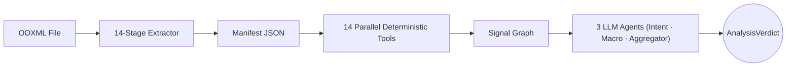

# OOXML Extractor + Agentic Analysis Engine

Research-grade **Microsoft Office OOXML extractor** with LLM-powered security analysis and a React/Vite UI.

> **Dual objective**: Extract *everything* from the Office document container, then
> analyze it for phishing, malware, and evasion using a deterministic-first,
> LLM-second pipeline.

---

## Architecture

```
ooxml-extractor/
  backend/          FastAPI extraction + agentic analysis engine
  frontend/         React + Vite UI
```



---

## Quick Start

### 1 — Backend

```bash
cd ooxml-extractor/backend
python3 -m venv .venv
source .venv/bin/activate
pip install -r requirements.txt

# Set your API key
export OPENAI_API_KEY="sk-..."

# Run the server
uvicorn app:app --reload --host 0.0.0.0 --port 8000
```

> API at **http://localhost:8000** · Docs at **http://localhost:8000/docs**

### 2 — Frontend

```bash
cd ooxml-extractor/frontend
npm install && npm run dev
```

> UI at **http://localhost:5173**

---

## Environment Variables

| Variable | Default | Description |
|---|---|---|
| `OPENAI_API_KEY` | *(required)* | OpenAI API key for agentic analysis |
| `WORKSPACE_ROOT` | `./ooxml_workspaces` | Root directory for extraction workspaces |
| `MAX_LLM_RETRIES` | `3` | Max retry attempts for LLM calls |
| `LLM_RETRY_BASE_DELAY` | `1.0` | Base delay (seconds) for exponential backoff |

---

## Extraction Pipeline (14 Stages)

| Stage | Name | What it does |
|-------|------|-------------|
| 1 | ZIP enumeration | Every entry, ZipSlip-safe, CRC32 + SHA-256, **zip bomb protection** |
| 2 | Content-type detection | `[Content_Types].xml` + path heuristics + magic bytes |
| 3 | XML decoding | UTF-8/UTF-16LE decode + XML summary |
| 4 | Binary classification | Dual-engine: Magic Byte + Google Magika ML |
| 5 | Structural role | Maps every path to an OOXML role |
| 6 | Relationship parsing | All `.rels` files, external URLs collected |
| 7 | VBA macro extraction | olevba + **encrypted VBA project detection** (`DPB=`) |
| 8 | XLM detection | Excel 4.0 macro sheet detection |
| 9 | DDE detection | DDEAUTO/DDE + **XML field code parsing** |
| 10 | Embedded objects | OLE enumeration, PE/RTF/PDF magic detection |
| 11 | **RTF content parsing** | Nested OLE objects, CVE-2017-11882 Equation Editor detection |
| 12 | **HTML/SVG extraction** | `<script>`, `<iframe>`, SVG event handlers, `data:` URIs |
| 13 | **Media validation** | EMF/WMF record analysis, font table validation, TIFF overflow checks |
| 14 | **Content_Types validation** | Duplicate overrides, dangerous MIME mappings, external schemas |

---

## Agentic Analysis Pipeline

14 deterministic tools run **in parallel** via `ThreadPoolExecutor`, then 3 LLM agents run sequentially:

### Deterministic Tools (14)

| Tool | Detects |
|------|---------|
| `macro_analyzer` | VBA macros, autoexec keywords, encrypted projects |
| `ole_analyzer` | Embedded OLE payloads, byte-level re-classification |
| `dde_analyzer` | DDE/DDEAUTO + XML `<w:instrText>` field code extraction |
| `xlm_analyzer` | 20+ dangerous XLM functions, CHAR() decode, anti-sandbox detection |
| `obfuscation_analyzer` | 13 VBA semantic patterns (StrReverse, CallByName, WMI, etc.) |
| `template_injection_analyzer` | 9 relationship types + dangerous protocols (mhtml, ms-msdt, UNC) |
| `structure_analyzer` | Deep nesting, duplicate hashes, anomalous paths |
| `prompt_injection_scanner` | Adversarial prompt injection with Unicode normalization |
| `ooxml_attack_analyzer` | Online video injection, ActiveX CLSID extraction (15 dangerous controls) |
| `pcode_analyzer` | VBA P-code stomping (source vs compiled binary disproportion) |
| `macroless_attack_analyzer` | QAT poisoning, webSettings frames, oleLink, external data connections |
| `url_validator` | Dangerous extensions, IP targets, URL shorteners, data: URIs |
| `html_svg_analyzer` | 12 JS attack patterns (eval, atob, fromCharCode, fetch) |
| `intent_analyzer` | Text statistics and intent keyword density (pre-LLM) |

### LLM Agents (3)

| Agent | Task |
|-------|------|
| `intent_analyzer` | Social engineering intent classification |
| `macro_behavior_analyzer` | VBA behavior analysis and risk scoring |
| `verdict_aggregator` | Final verdict with **deterministic floor enforcement** |

### Verdict Floor (deterministic override)

The LLM **cannot** downgrade these signals to CLEAN:

| Signal | Minimum Verdict |
|--------|----------------|
| DDE with extracted commands | MALICIOUS |
| Dangerous ActiveX CLSIDs | MALICIOUS |
| VBA P-code stomping | MALICIOUS |
| XLM dangerous functions | SUSPICIOUS |
| Obfuscated macros | SUSPICIOUS |
| Encrypted VBA project | SUSPICIOUS |
| Embedded high-risk payloads | SUSPICIOUS |
| Prompt injection detected | SUSPICIOUS |
| Macro-less structural attacks | SUSPICIOUS |
| HTML/SVG active scripts | SUSPICIOUS |
| Template injection | *No floor* (can be legit) |

---

## Security Features

- **ZipSlip prevention**: every path validated before writing
- **Zip bomb protection**: 200MB cumulative, 100MB/entry, 10K entry cap
- **No execution**: purely static analysis — no macros executed
- **Unicode normalization**: zero-width character stripping (30+ invisible chars)
- **LLM guardrails**: applied at all 3 call sites via `build_system_guardrail()`
- **LLM retry**: exponential backoff with configurable max retries
- **Office decryption**: encrypted documents decrypted via `msoffcrypto-tool`
- **No hardcoded keys**: `OPENAI_API_KEY` required from environment
- **Parallel tools**: 14 deterministic tools run concurrently

---

## Running Tests

```bash
cd ooxml-extractor/backend
source .venv/bin/activate
pytest tests/ -v
```

---

## Supported Formats

| Extension | Format |
|-----------|--------|
| `.docx` `.docm` | Word Document |
| `.dotx` `.dotm` | Word Template |
| `.xlsx` `.xlsm` | Excel Workbook |
| `.xltx` `.xltm` | Excel Template |
| `.xlsb` | Excel Binary Workbook |
| `.pptx` `.pptm` | PowerPoint Presentation |
| `.potx` `.potm` | PowerPoint Template |
| `.zip` | Generic ZIP / unknown OOXML |
