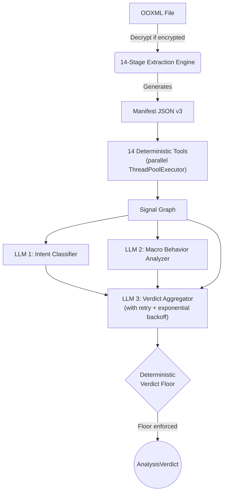

# Agentic Analysis Engine: Technical Guide

This document describes the technical architecture, data flow, and security mechanisms of the OOXML Agentic Analysis pipeline. The system combines deterministic extraction with LLM-backed evaluation to produce high-confidence verdicts on potentially malicious documents.

---

## 1. System Architecture

The engine operates on the JSON **Manifest** produced by the 14-stage extraction layer. It never executes the raw OOXML file.



---

## 2. Extraction Layer (14 Stages)

| # | Stage | Module | Purpose |
|---|-------|--------|---------|
| 1 | ZIP enumeration | `zip_reader.py` | ZipSlip-safe extraction, zip bomb protection (200MB/100MB/10K limits) |
| 2 | Content-type detection | `content_type_detector.py` | `[Content_Types].xml` + magic bytes |
| 3 | XML decoding | `xml_decoder.py` | UTF-8/UTF-16LE decode, XML summary |
| 4 | Binary classification | `binary_classifier.py` | Dual-engine: Magic Byte (28 types) + Google Magika ML |
| 5 | Structural role mapping | `structure_enumerator.py` | OOXML role assignment |
| 6 | Relationship parsing | `rels_parser.py` | `.rels` files, external URL collection |
| 7 | VBA macro extraction | `macro_vba_extractor.py` | olevba extraction + `DPB=`/`DPx=` encrypted project detection |
| 8 | XLM detection | `xlm_extractor.py` | Excel 4.0 macro sheet detection |
| 9 | DDE detection | `dde_detector.py` | DDEAUTO/DDE pattern scanning |
| 10 | Embedded objects | `ole_embedded_extractor.py` | OLE stream enumeration |
| 11 | RTF parsing | `rtf_extractor.py` | `\objdata` OLE, Equation Editor CLSID (CVE-2017-11882) |
| 12 | HTML/SVG extraction | `html_svg_extractor.py` | `<script>`, `<iframe>`, SVG events, `data:` URIs |
| 13 | Media validation | `media_validator.py` | EMF/WMF records, font tables, TIFF overflow checks |
| 14 | Content_Types validation | `content_type_validator.py` | Duplicate overrides, dangerous MIME mappings |

Optional **pre-stage**: Encrypted documents are decrypted via `msoffcrypto-tool` using `VelvetSweatshop` and common passwords before extraction.

---

## 3. Analysis Layer — Deterministic Tools (14, Parallel)

All tools run concurrently in a `ThreadPoolExecutor(max_workers=6)` with per-tool error isolation.

| Tool | Input | Detects |
|------|-------|---------|
| `macro_analyzer` | `manifest.macros` | VBA presence, autoexec keywords, encrypted projects |
| `ole_analyzer` | `manifest.embedded_objects` | OLE payloads, byte-level re-classification, type discrepancies |
| `dde_analyzer` | `manifest.dde_findings` + raw XML | DDE commands from `<w:instrText>`, `<w:fldSimple>` |
| `xlm_analyzer` | `manifest.xlm_findings` | 20+ dangerous functions (EXEC, RUN, CALL, REGISTER), CHAR decode |
| `obfuscation_analyzer` | Macro code + decoded text | 13 semantic patterns: StrReverse, CallByName, Replace, WMI, Environ |
| `template_injection_analyzer` | `manifest.rels_files` | 9 relationship types: attachedTemplate, oleObject, frame, subdocument, etc. + mhtml/ms-msdt protocols |
| `structure_analyzer` | `manifest.entries` | Deep nesting, duplicate hashes, anomalous paths |
| `prompt_injection_scanner` | Decoded text | Adversarial injection with NFKC normalization + zero-width stripping |
| `ooxml_attack_analyzer` | Entries + ActiveX bins | Online video, ActiveX CLSID extraction (15 known-dangerous controls) |
| `pcode_analyzer` | Macro results + OLE streams | P-code stomping: source vs compiled binary disproportion |
| `macroless_attack_analyzer` | Manifest-wide | QAT poisoning, webSettings frames, oleLink, external connections, encoded properties |
| `url_validator` | `manifest.urls` + rels targets | Dangerous extensions, IP targets, shorteners, data: URIs, UNC paths |
| `html_svg_analyzer` | Entries + decoded text | 12 JS patterns (eval, atob, fromCharCode, fetch), dangerous tags |
| `intent_analyzer` (stats) | Decoded text | Text length, keyword density — pre-LLM |

---

## 4. Analysis Layer — LLM Agents (3, Sequential)

| Agent | Purpose | Guardrails |
|-------|---------|------------|
| **Intent Classifier** | Determine social engineering objective (invoice, login_request, urgency, etc.) | XML-stripped text, `guardrails.sanitize_for_prompt()` |
| **Macro Behavior Analyzer** | Analyze VBA code for harmful capabilities and execution intent | Runs only when macros present |
| **Verdict Aggregator** | Correlate all signals → final verdict + MITRE ATT&CK mapping | Structured output via `AggregatorResponse` Pydantic model |

All LLM calls:
- Use `build_system_guardrail()` preamble
- Enforce structured Pydantic output via `client.beta.chat.completions.parse()`
- Retry up to `MAX_LLM_RETRIES` (default 3) with exponential backoff

---

## 5. Verdict Floor (Deterministic Override)

After the LLM returns a verdict, a deterministic floor prevents downgrading confirmed threats to CLEAN:

| Signal | Min Verdict | Rationale |
|--------|------------|-----------|
| DDE with extracted commands | **MALICIOUS** | Confirmed weaponized DDE |
| Dangerous ActiveX CLSIDs | **MALICIOUS** | Known-exploit controls |
| P-code stomping detected | **MALICIOUS** | Confirmed evasion technique |
| XLM dangerous functions | SUSPICIOUS | Rarely legitimate |
| Obfuscated macros | SUSPICIOUS | Evasion indicator |
| Encrypted VBA project | SUSPICIOUS | Cannot inspect hidden code |
| High-risk embedded objects | SUSPICIOUS | Executable payloads |
| Prompt injection detected | SUSPICIOUS | Adversarial content |
| Macro-less structural attacks | SUSPICIOUS | QAT/oleLink/external connections |
| HTML/SVG active scripts | SUSPICIOUS | Script smuggling |
| Template injection | **No floor** | Can be legitimate |

If the LLM is unavailable after all retries, a deterministic fallback produces the verdict using the same floor logic + risk scoring.

---

## 6. Signal Graph Schema

```python
class SignalGraph(BaseModel):
    visible_text_length:        int
    has_macros:                 bool
    autoexec_keywords:          list[str]
    dde_detected:               bool
    xlm_detected:               bool
    obfuscation_detected:       bool
    template_injection_detected: bool
    prompt_injection_detected:  bool
    has_online_video:           bool
    has_activex:                bool
    has_dangerous_activex:      bool
    has_rtf_exploits:           bool
    has_html_svg_payloads:      bool
    has_media_anomalies:        bool
    content_type_poisoning:     bool
    encrypted_vba_detected:     bool
    macroless_attacks_detected: bool
    suspicious_urls:            list[str]
    pcode_stomping_detected:    bool
    doc_metadata:               dict     # pages, slides, word count
    raw_signals:                dict     # full tool outputs
```

---

## 7. Security Guardrails

1. **Schema Enforcement**: All LLM agents use `client.beta.chat.completions.parse` with strict Pydantic models
2. **No Raw Text to Aggregator**: Only structured `SignalGraph` (excluding `raw_signals`) is sent to the final LLM
3. **Unicode Normalization**: NFKC normalization + 30+ zero-width characters stripped before injection scanning
4. **Guardrail Preamble**: `build_system_guardrail()` is injected at all 3 LLM call sites
5. **XML Sanitization**: Visible text is XML-stripped before intent classification
6. **Deterministic Floor**: LLM cannot override confirmed threats (see §5)
7. **Parallel Isolation**: Tool failures in `ThreadPoolExecutor` are caught individually — no cascading
8. **Zip Bomb Protection**: 200MB cumulative, 100MB per-entry, 10K total entry limits
9. **Office Decryption**: `msoffcrypto-tool` attempts `VelvetSweatshop` + common passwords on encrypted files
10. **No Hardcoded Keys**: `OPENAI_API_KEY` must be set via environment variable
