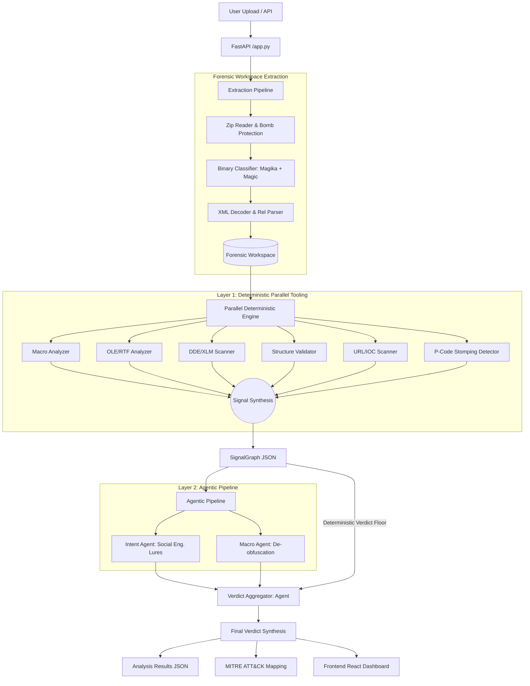

# OOXML Static Analysis Engine: Technical Implementation Guide

This document provides a deep dive into the architecture, design philosophy, and internal mechanics of the OOXML Static Analysis Engine. It is intended for technical cybersecurity professionals and developers.

## 1. Detection Philosophy: The Hierarchical Analysis Model

Traditional static analysis often falls into one of two traps: being too rigid (signature-based) or too noisy (standard LLM-only analysis). This engine employs a **Hierarchical Analysis Model** that balances speed, cost, and accuracy across three distinct layers.

### The Three Layers of Truth
1.  **Layer 1: Deterministic Truth (Local)**
    *   **Goal:** Fast extraction of undeniable facts.
    *   **Mechanics:** Parallel execution of 14+ specialized Python tools.
    *   **Outcome:** A `SignalGraph` containing structural anomalies, extracted macros, embedded binaries, and suspicious field codes.
2.  **Layer 2: Probabilistic Context (LLM Agents)**
    *   **Goal:** Human-like understanding of intent and obfuscation.
    *   **Mechanics:** Isolated LLM calls for macro de-obfuscation and social engineering intent classification.
    *   **Outcome:** Structured agent reports mapping signals to patterns.
3.  **Layer 3: Synthesis & Verdict (Aggregator)**
    *   **Goal:** Correlation of all signals into a finalized verdict.
    *   **Mechanics:** A final LLM "Expert" review of Layers 1 and 2.
    *   **Outcome:** Final verdict (`CLEAN`, `SUSPICIOUS`, `MALICIOUS`) with reasoning and MITRE mapping.

### The Deterministic Verdict Floor
To prevent LLM hallucinations from resulting in False Negatives for known-malicious structures, the engine enforces a **Deterministic Floor**. If Layer 1 detects a critical threat (e.g., Template Injection with a high-risk URL or a locked VBA project), the Aggregator is strictly instructed that the verdict *cannot* be "CLEAN".

---

## 2. Architecture Diagram



---

## 3. Core Component Internals

### 3.1 Manifest Builder (`extractor.py`)
The system never works directly with the raw `.docx` or `.xlsx` files after ingestion. It extracts every internal XML part and binary stream into a forensic workspace.
*   **Security:** Protections against ZipSlip and ZipBombs.
*   **Classification:** Uses a dual-engine approach (Magic Bytes + Google Magika) to classify every internal member of the ZIP archive.

### 3.2 Parallel Deterministic Engine (`deterministic_engine.py`)
Execution is parallelized using `ThreadPoolExecutor`. Specialized tools include:
*   **XLM Detector:** Searches for Excel 4.0 Macros in dedicated sheets.
*   **P-Code Validator:** Detects "VBA Stomping" by comparing compiled P-Code to VBA source code.
*   **Content Type Validator:** Checks for `[Content_Types].xml` poisoning attacks.
*   **RTF/HTML Extractor:** Deep-walks through embedded object relationships to find hidden OLE payloads.

### 3.3 Agentic Pipeline & Aggregator
The Aggregator (`verdict_aggregator.py`) acts as the "Senior Analyst." It receives the `SignalGraph` and the "Agent" reports.
*   **Fallback Logic:** If the LLM analysis fails after retries, the system falls back to a purely deterministic verdict based on the risk scores in the SignalGraph. It will NEVER "fail open" to CLEAN if signals are present.

---

## 4. JSON Schemas

### 4.1 SignalGraph (Input to Analysis)
The `SignalGraph` represents the "State of the Document" after deterministic analysis.

```json
{
  "doc_metadata": {
    "filename": "invoice.xlsm",
    "file_size": 46886,
    "doc_type": "Excel Macro-Enabled Workbook"
  },
  "has_macros": true,
  "macro_module_count": 6,
  "autoexec_keywords": ["Auto_Open"],
  "obfuscation_detected": true,
  "embedded_objects": 7,
  "raw_signals": {
    "macros": {
      "suspicious_keywords": ["WScript.Shell", "ADODB.Stream", "CreateObject"],
      "macro_code": "...(Extracted VBA Source)..."
    },
    "ole": {
      "risk_score": 60,
      "verified_objects": [
        { "path": "xl/embeddings/oleObject1.bin", "is_risky": true }
      ]
    }
  }
}
```

### 4.2 Analysis Verdict (System Output)
The final result returned to the user or API.

```json
{
  "verdict": "MALICIOUS",
  "confidence": 0.95,
  "risk_score": 85,
  "intent": "social_engineering_phish",
  "reasoning": [
    "Macro attempts to download and execute an external binary.",
    "Utilizes ADODB Stream and FileSystemObject for disk persistence.",
    "Presence of Auto_Open ensures execution on document load."
  ],
  "mitre_techniques": [
    { "id": "T1059.005", "name": "Visual Basic" },
    { "id": "T1203", "name": "Exploiting Vulnerability" }
  ]
}
```

---

## 5. Case Study: Malicious VBA Downloader

### Sample: `a9bc2d16...xlsm` (Malicious)

**1. Observations from Layer 1:**
- **Signal:** `Auto_Open` macro detected in `Module1.bas`.
- **Signal:** 7 embedded OLE objects found, 4 verified as compound documents.
- **Signal:** Multiple Base64-like strings found in the VBA source code.

**2. Layer 2 Agent Analysis:**
- **Intent Agent:** Identifies "No visible text" (Length 27 chars), suggesting the document is a shell for code delivery rather than a legitimate spreadsheet.
- **Macro Agent:** De-obfuscates the strings:
    - `aHR0cDovLzg4LjIxOC4xNi4zNy9ScnI0NU1BOHByQ0pVV2guZXhl` -> `http://88.218.16.37/Srr45MA8prCJUWh.exe`
    - Identifies logic for downloading a `.exe` to `C:\ProgramData` using `ADODB.Stream`.

**3. Layer 3 Synthesis:**
- The engine correlates the lack of visible content with the high-risk "Download-and-Execute" pattern.
- The **Deterministic Floor** ensures that the presence of an IP-based download URI in a macro results in a non-negotiable `MALICIOUS` verdict.

**Verdict Result:** `MALICIOUS` (Confidence: 0.95, Risk Score: 85).

---

## 6. Provenance & Artifacts
The engine maintains a complete forensic workspace for every analyzed file:
- `/analysis/signal_graph.json`: Raw deterministic findings.
- `/analysis/verdict.json`: Final integrated results.
- `/extraction/`: Every individual XML part and binary stream extracted from the OOXML.
- `/logs/`: Detailed trace of the analysis pipeline.
